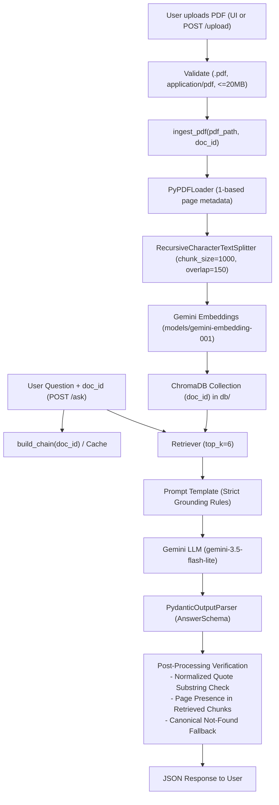

# Document Q&A (Generalized PDF RAG Assistant)

A grounded Retrieval-Augmented Generation (RAG) assistant for querying **any PDF document** with strict citations and zero hallucination.

Users can upload any PDF (up to 20MB), which is automatically parsed, split into text chunks, embedded via Gemini, and indexed into a dedicated ChromaDB collection. The assistant answers technical questions with exact section names, 1-based page numbers, and verbatim quotes from the document. If information is not explicitly documented or only partially supported, the system strictly outputs **"Not found"**.

---

Deployed Link: https://gas-turbine-rag.onrender.com

## Architecture Flow



---

## Tech Stack

- **Language & Runtime**: Python 3.10+
- **RAG & Orchestration**: LangChain, LangChain Community, LangChain Google GenAI, LangChain Chroma
- **Embeddings**: Google Generative AI Embeddings (`models/gemini-embedding-001`, 3072-dim)
- **Vector Database**: ChromaDB (isolated collection per document in `db/`)
- **LLM**: Google Gemini (`gemini-3.5-flash-lite`)
- **PDF Processing**: `pypdf`
- **Output Parsing & Validation**: Pydantic v2
- **Backend API**: FastAPI, Uvicorn, Python-Multipart
- **Frontend**: ChatGPT-style Vanilla HTML/CSS/JS (drag-and-drop file upload, sidebar document info, dynamic `doc_id` session, and localStorage persistence)

---

## API Endpoints

### 1. `POST /upload`
Uploads and indexes any PDF into ChromaDB.
- **Request**: Multipart Form Data with `file` field (`.pdf`, `application/pdf`, max 20MB).
- **Process**: Generates a 12-character hexadecimal `doc_id`, saves to `uploads/`, splits text, embeds chunks, and builds a collection named `doc_id`.
- **Response**:
  ```json
  {
    "doc_id": "56b6999d72ea",
    "filename": "document.pdf",
    "pages": 60,
    "chunks": 270
  }
  ```
- **Error Codes**: `400` for invalid format, size > 20MB, empty file, or scanned PDFs with no readable text; `500` for internal errors.

### 2. `POST /ask`
Queries a specific document collection using the grounded RAG chain.
- **Request Body**:
  ```json
  {
    "question": "What are the three main types of inspection?",
    "doc_id": "56b6999d72ea"
  }
  ```
- **Response (Found)**:
  ```json
  {
    "found": true,
    "answer": "The three types of scheduled inspections for all gas turbines in the GE Vernova Annular/Silo fleet are Type A Visual Inspection, Type B Visual Inspection, and Type C Major Inspection.",
    "pages": [32],
    "section": "ABC Inspections For Annular/Silo Fleet",
    "quote": "Type A Visual Inspection, Type B Visual Inspection, and Type C Major Inspection"
  }
  ```
- **Response (Not Found)**:
  ```json
  {
    "found": false,
    "answer": "Not found",
    "pages": [],
    "section": "",
    "quote": ""
  }
  ```
- **Error Codes**: `400` if `question` or `doc_id` is empty; `404` if the `doc_id` collection does not exist; `500` on server error.

### 3. `GET /health`
Health check endpoint returning `{"status": "ok"}`.

### 4. `GET /`
Serves the ChatGPT-style single-page web application.

---

## Setup & Running Locally

### 1. Clone & Set Up Virtual Environment

```bash
git clone <repo-url>
cd AskPDF
python3 -m venv .venv
source .venv/bin/activate
pip install -r requirements.txt
```

### 2. Configure Environment Variables

Create `.env` based on `.env.example`:
```bash
cp .env.example .env
```
Open `.env` and insert your Gemini API key:
```env
GOOGLE_API_KEY=your_gemini_api_key_here
```

### 3. Ingest via CLI (Optional)

You can index documents directly from the terminal:
```bash
python ingest.py <path_to_pdf> [doc_id]
```

### 4. Start the Application Server

Start FastAPI with Uvicorn:
```bash
uvicorn server:app --port 8000
```

Open `http://localhost:8000` in your browser.

---

## How Citations and "Not Found" Work

Grounding is enforced deterministically at two stages:

1. **System Prompt Rules**:
   - The LLM is instructed to answer **strictly** from the retrieved context without using outside knowledge.
   - If the context only partially answers or the fact is absent, `found` is set to `false`.
   - The model must supply a verbatim supporting quote under 25 words from the context.

2. **Deterministic Post-Processing (`postprocess` in `rag_chain.py`)**:
   - **Quote Verification**: The model's quote is whitespace- and case-normalized. The first distinctive words must exist as an exact substring in the retrieved text. If not matched, the answer is discarded and replaced with `Not found`.
   - **Page Verification**: All page numbers in `pages` must exist in the metadata of the retrieved chunks. If any page is invalid, it is pruned. If no valid pages remain, `Not found` is returned.
   - **Canonical Not-Found**: Exactly returns `{"answer": "Not found", "found": false, "pages": [], "section": "", "quote": ""}`.

---

## Project Structure

```
.
├── config.py              # Settings: CHUNK_SIZE, CHUNK_OVERLAP, TOP_K, UPLOAD_DIR, MAX_UPLOAD_MB
├── data/                  # Sample PDFs (data/GER-3620-P.pdf, test_solar.pdf)
├── db/                    # Local ChromaDB persistent vector database
├── frontend/
│   └── index.html         # ChatGPT-style web UI with drag-and-drop PDF upload & dynamic session
├── ingest.py              # ingest_pdf(pdf_path, doc_id) and CLI ingestion
├── rag_chain.py           # build_chain(doc_id), AnswerSchema, generalized prompt, postprocess
├── server.py              # FastAPI application server (POST /upload, POST /ask, GET /, GET /health)
├── test_pipeline.py       # End-to-end Python test suite for upload, querying, isolation & errors
├── requirements.txt       # Python dependencies (includes python-multipart)
├── answers.md             # Benchmark answers table
├── PROGRESS.md            # Project progress tracking and verification log
├── screenshots/           # UI captures
├── .env.example           # Example environment template
└── README.md              # Project documentation
```

> **Note on Page Numbers**: All page citations are 1-based (Page 1 corresponds to the document cover, exactly matching PDF viewer page indexing).
# AskPDF
