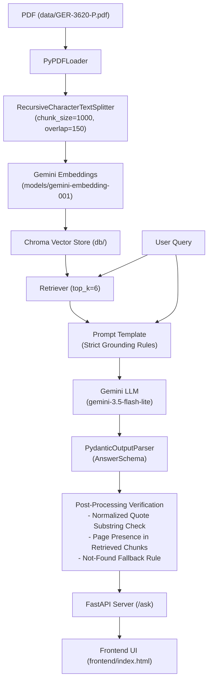
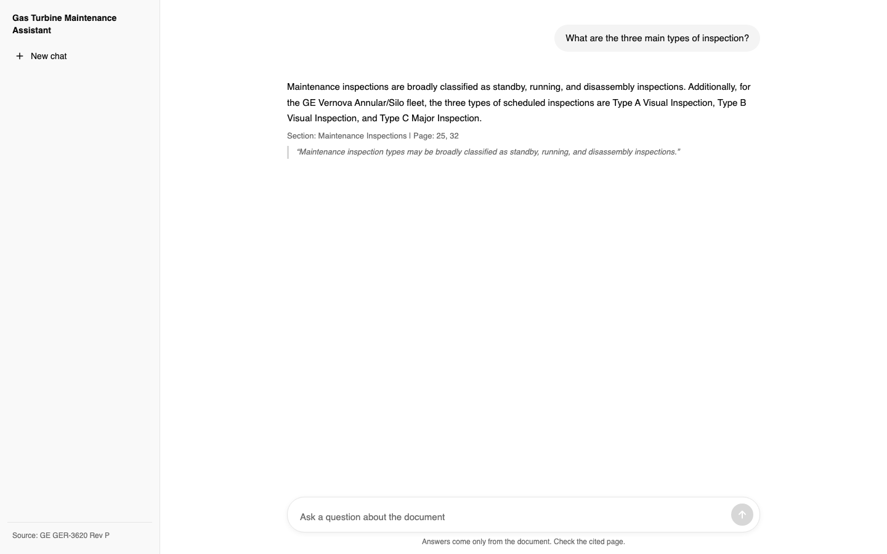
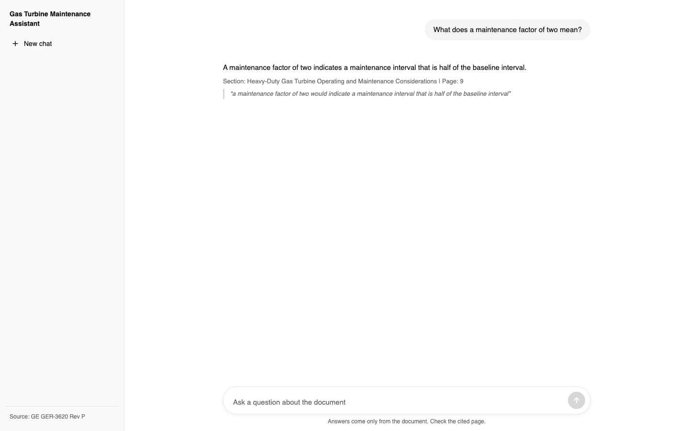
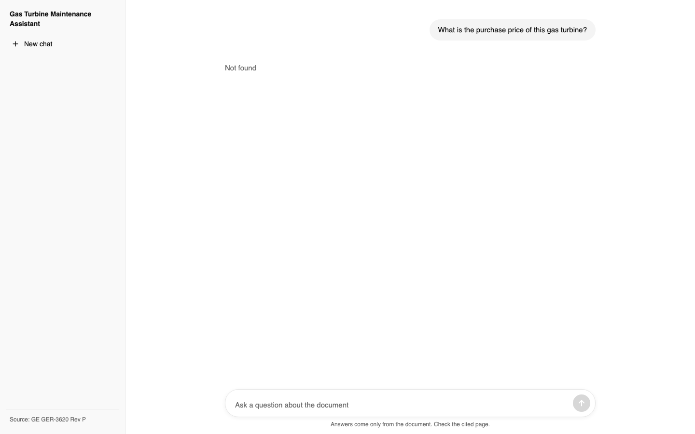
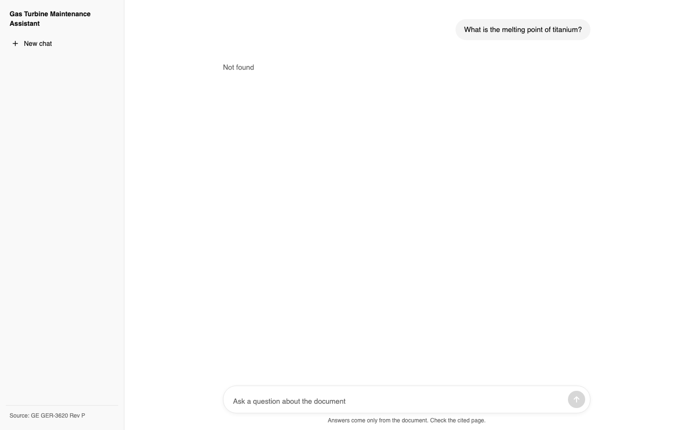
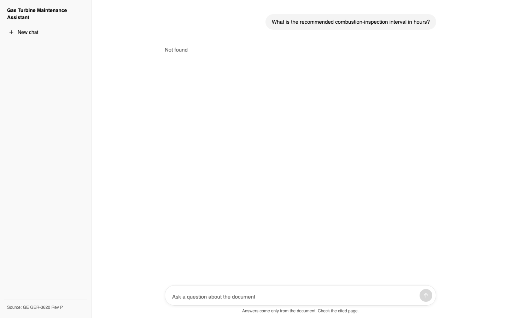

# Gas Turbine Maintenance Assistant (GE GER-3620 RAG)

A grounded Retrieval-Augmented Generation (RAG) assistant for General Electric (GE Vernova) heavy-duty gas turbine operation and maintenance documentation (**GE GER-3620 Rev P**, 60 pages). 

The assistant answers technical questions with exact section names, 1-based page numbers, and verbatim quotes from the text. If information is not explicitly documented or only partially supported, the system strictly outputs **"Not found"** to eliminate hallucinations.

---

Deployed Link : https://gas-turbine-rag.onrender.com

## Architecture Flow



---

## Tech Stack

- **Language & Runtime**: Python 3.10+
- **RAG & Orchestration**: LangChain, LangChain Community, LangChain Google GenAI, LangChain Chroma
- **Embeddings**: Google Generative AI Embeddings (`models/gemini-embedding-001`, 3072-dim)
- **Vector Database**: ChromaDB (local persistence in `db/`)
- **LLM**: Google Gemini (`gemini-3.5-flash-lite`)
- **PDF Processing**: `pypdf`
- **Output Parsing & Validation**: Pydantic v2
- **Backend API**: FastAPI, Uvicorn
- **Frontend**: ChatGPT-style Vanilla HTML/CSS/JS (embedded single-page application, neutral palette, sidebar, and chat-thread layout)

---

## Setup & Running Locally

### 1. Clone & Set Up Virtual Environment

```bash
git clone <repo-url>
cd gas-turbine-rag
python3 -m venv .venv
source .venv/bin/activate
pip install -r requirements.txt
```

### 2. Configure Environment Variables

Create `.env` based on `.env.example`:
```bash
cp .env.example .env
```
Open `.env` and insert your Gemini API key:
```env
GOOGLE_API_KEY=your_gemini_api_key_here
```

### 3. Ingest the Document into ChromaDB

Parse `data/GER-3620-P.pdf`, chunk into text segments with 1-based page numbers, generate embeddings, and persist into `db/`:
```bash
python ingest.py
```

### 4. Start the Application Server

Start FastAPI with Uvicorn:
```bash
uvicorn server:app --port 8000
```

Open `http://localhost:8000` in your browser.

---

## How Citations and "Not Found" Work

Grounding is enforced at two stages:

1. **System Prompt Rules**:
   - The LLM is instructed to answer **only** using explicitly provided context.
   - If the context only partially answers or the fact is absent (e.g. turbine purchase price or melting point of titanium), `found` must be set to `false`.
   - The model must extract a verbatim quote (< 25 words) from the context supporting every claim.

2. **Deterministic Post-Processing (`postprocess` in `rag_chain.py`)**:
   - **Quote Verification**: The model's quote is whitespace- and case-normalized. The first distinctive words must exist as a substring within the retrieved context chunks. If not matched, the answer is discarded and replaced with `Not found`.
   - **Page Verification**: All page numbers in `pages` must be present among the metadata of the retrieved chunks. If any page is invalid, it is pruned. If no valid pages remain, `Not found` is returned.
   - **Canonical Not-Found**: Returns `{"answer": "Not found", "found": false, "pages": [], "section": "", "quote": ""}`.

---

## Target Questions & Results

The system was evaluated against the 5 benchmark questions from `answers.md`:

| Question | Answer | Section | Page | Quote |
|---|---|---|---|---|
| What are the three main types of inspection? | Maintenance inspection types are broadly classified as standby, running, and disassembly inspections. For the GE Vernova Annular/Silo fleet, the three types of scheduled inspections are Type A Visual Inspection, Type B Visual Inspection, and Type C Major Inspection. | Maintenance Inspections | 25, 32 | Maintenance inspection types may be broadly classified as standby, running, and disassembly inspections. |
| What does a maintenance factor of two mean? | A maintenance factor of two indicates a maintenance interval that is half of the baseline interval. | Heavy-Duty Gas Turbine Operating and Maintenance Considerations | 9 | a maintenance factor of two would indicate a maintenance interval that is half of the baseline interval |
| What is the purchase price of this gas turbine? | Not found | - | - | - |
| What is the melting point of titanium? | Not found | - | - | - |
| What is the recommended combustion-inspection interval in hours? | The recommended combustion-inspection interval in hours varies by turbine model, such as 12,000 hours for 6B (DLN) and up to 32,000 hours for 7F (DLN) baseline conditions. | Figure 36 . Baseline recommended inspection intervals: base load – natural gas fuel – dry | 33 | Combustion (DLN) Factored 12000/450 |

---

## UI Screenshots

### Q1: Three Main Types of Inspection

*Figure 1: ChatGPT-style interface displaying standby, running, and disassembly inspections cited from page 25 alongside Annular/Silo Type A/B/C from page 32.*

### Q2: Maintenance Factor of Two

*Figure 2: Grounded definition from page 9 showing that a maintenance factor of two halves the baseline maintenance interval.*

### Q3: Purchase Price (Out of Domain)

*Figure 3: Strictly returning "Not found" when financial/commercial data is queried.*

### Q4: Melting Point of Titanium (Out of Domain)

*Figure 4: Strictly returning "Not found" for external material physics facts absent in GER-3620.*

### Q5: Recommended Combustion-Inspection Interval

*Figure 5: Combustion inspection interval in hours from Figure 36 on page 33.*

---

## Project Structure

```
.
├── config.py              # Centralized configuration (models, chunking, top_k)
├── data/
│   └── GER-3620-P.pdf     # Source GE documentation (60 pages)
├── db/                    # Local ChromaDB persistent vector database
├── frontend/
│   └── index.html         # ChatGPT-style single-page web UI (vanilla CSS & JS)
├── ingest.py              # Ingestion pipeline: load, split, embed, persist
├── rag_chain.py           # LCEL chain, AnswerSchema, prompt, postprocessing
├── run_questions.py       # Benchmark script for the 5 target questions -> answers.md
├── capture_screenshots.py # Automation script for capturing UI screenshots
├── server.py              # FastAPI application server (/ask, /, /health)
├── answers.md             # Benchmark answers table
├── PROGRESS.md            # Project progress tracking and verification log
├── requirements.txt       # Python dependencies
├── screenshots/           # UI captures (chatgpt_q1.png - chatgpt_q5.png)
├── .env.example           # Example environment template
└── README.md              # Project documentation
```

> **Note on Page Numbers**: All page citations are 1-based (Page 1 corresponds to the document cover, exactly matching PDF viewer page indexing).
